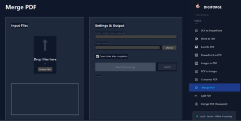

# DIGIFORGE 🛠️

> **Local, Secure, and Offline PDF & Document Management Application**  
> Solusi pengelolaan dokumen digital aman berbasis desktop untuk **Problem Owner**.

---

## 🔒 Latar Belakang & Permasalahan

Pengelolaan dokumen digital di Pihak Owner saat ini masih bergantung pada layanan *cloud* pihak ketiga untuk konversi, kompresi, dan pemisahan PDF. Hal ini berpotensi menimbulkan **risiko kebocoran data sensitif** serta masalah ketergantungan pada koneksi internet.

**DIGIFORGE** hadir sebagai solusi aplikasi *desktop* lokal yang memungkinkan pemrosesan dokumen secara **100% offline**, aman, dan terintegrasi.

---

## ✨ Fitur Utama

- **📄 Document Processing & Conversion**
  - PDF ↔ Word, Excel, PowerPoint
  - Images ↔ PDF
- **⚙️ Document Management**
  - Compress, Merge, Split PDF
  - Encrypt / Protect PDF
- **✍️ Digital Signature Tools**
  - Built-in **Signature Pad** (Membuat TTD transparan PNG)
  - Add Signature to PDF

---

## 🎯 Keunggulan

- **100% Offline Processing:** Berkas tidak pernah diunggah ke server eksternal/cloud.
- **Data Privacy Guaranteed:** Mencegah risiko *data leak* dokumen rahasia lembaga.
- **No Internet Required:** Dapat berjalan kapan saja tanpa tergantung koneksi internet.

---

## 🎨 Antarmuka Pengguna (UI)

Aplikasi dirancang dengan antarmuka modern (Dark Mode) yang intuitif:
- **Input Zone:** Layar interaktif pendukung *Drag & Drop*.
- **Settings & Output:** Pengaturan nama file, target folder simpan, dan indikator status.
- **Tools Sidebar:** Akses cepat ke seluruh fitur konversi dan tanda tangan digital.

---

## 🛠️ Metodologi Pengembangan

1. **Analisis Kebutuhan:** Pemetaan alur dokumen internal pegawai.
2. **Perancangan Sistem Offline:** Desain UI/UX & integrasi engine PDF lokal.
3. **Pengembangan & Testing:** Prototipe, unit testing, dan UAT pengguna.
